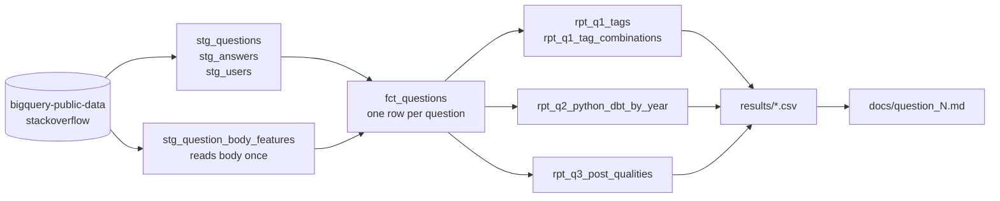

# Take-Home Assignment: Stack Overflow Analysis

A take-home assignment for Newsela. Three questions about Stack Overflow, answered in SQL (dbt on
BigQuery) over the public dataset `bigquery-public-data.stackoverflow`, a static snapshot ending
2022-09-25. Python scripts add the statistics (intervals, tests, correlations) and check each
write-up against the exported CSVs.

**Stack:** BigQuery Standard SQL, dbt-core 1.12, dbt-bigquery, dbt_utils, Python 3.11
(standard library only for the analysis scripts; matplotlib for the charts).

## Answers at a glance

### Q1. Tags

> *What tags on a Stack Overflow question lead to the most answers and the highest rate of
> approved answers for the current year? What tags lead to the least? How about combinations
> of tags?*

**Answer (2022, January to late August):**
- **Most:** text and data manipulation tags. awk and sed get the most answers per question
  (2.44 and 2.18, against 0.80 overall); awk, jq, data.table and dplyr the highest acceptance
  (64–67% get a community-accepted answer, against 27%). In total answers python, javascript
  and reactjs lead, mostly because they are the largest tags.
- **Least:** platform and tooling tags. facebook gets the fewest answers per question (0.28);
  appium, cordova and facebook the lowest acceptance (6.5–6.8%).
- **Combinations:** javascript|regex, dplyr|r and python|regex lead (64–66%);
  android|react-native (7.5%) and woocommerce|wordpress (10.4%) trail. The more common a
  question's exact tag set, the higher its acceptance (40% vs 22%).
- **Confidence:** high for the gap between top and bottom groups; the order inside each group
  is not statistically established.

[Full write-up](docs/question_1.md) · [tags CSV](results/q1_tags.csv) ·
[combinations CSV](results/q1_tag_combinations.csv)

### Q2. python vs dbt

> *For posts which are tagged with only ‘python’ or ‘dbt’, what is the year over year change
> of question-to-answer ratio for the last 10 years? How about the rate of approved answers on
> questions for the same time period? How do posts tagged with only ‘python’ compare to posts
> only tagged with ‘dbt’?*

**Answer (2013–2022; 2022 runs to late August):**
- **Question-to-answer ratio:** python-only rose from 0.46 (2013) to 0.67 (2021), +44%, so
  each question gets fewer answers; the yearly changes range from −1.6% to +16.7%, and 2022
  adds +16.7% (0.78). dbt-only exists only from 2020: 0.89, then +23.6% and −2.9%.
- **Approved answers:** python-only community acceptance fell from 63.9% to 41.5% (2013–2021,
  about −2.8 pp a year), and 6 of the 8 yearly drops exceed their margin of error; 2022 adds
  −5.7 pp, possibly overstated. dbt-only changed −6.8 pp and +3.1 pp, both within a margin of
  about ±14–18 pp: no dbt trend can be stated.
- **python vs dbt:** dbt-only questions get fewer answers (ratio 0.89–1.09 vs 0.62–0.78 in
  2020–2022) and about half the acceptance (21.7% vs 41.0% pooled, a gap of 19.3 ± 6.5 pp).
- **Confidence:** high for the python decline; moderate for the python vs dbt gap (157 dbt
  questions); none for a dbt trend.

[Full write-up](docs/question_2.md) · [CSV](results/q2_python_dbt_by_year.csv)

### Q3. Post qualities

> *Other than tags, what qualities on a post correlate with the highest rate of answer and
> approved answer? Feel free to get creative.*

**Answer (2022, January to late August; checked against 2013–2022):**
- **Code in the body:** the strongest. Questions with at least one code block are answered
  62–65% of the time and get a community-accepted answer 28–32% of the time, against 51.0% and
  18.1% without code.
- **Asker's account age:** accounts created the same day do worst (55.4% answered, 20.0%
  accepted); accounts from one day to three years old do best (61–63% and 28–29%).
- **Body length and error reports:** bodies of 500–1,999 characters do best (29–30% accepted),
  4,000+ worst (23.1%); describing an error in prose goes with lower acceptance (22.9% vs 28.6%).
- **Smaller (2–5 pp):** a shorter title, fewer tags, a question mark in the title, fewer links,
  posting on a weekend. Images show no consistent association.
- **Confidence:** high for code, account age, body length and error reports (same direction in
  every year, among never-edited and among python-only questions); moderate to low for the rest.

[Full write-up](docs/question_3.md) · [CSV](results/q3_post_qualities.csv)

All results are **associations**: the data cannot show that a tag or a post quality causes an
answer.

## Definitions and assumptions

| Item | Definition |
|---|---|
| Current year | 2022, the latest year in the dump, January to about 2022-08-26 |
| Observation window | answers count only if posted within 30 days of the question; questions without a full 30-day window are excluded. 94.7% of first answers arrive within 30 days |
| Answered | at least one answer within 30 days |
| Community-accepted | the accepted answer was posted within 30 days and written by someone other than the asker. The main acceptance metric; the rate including self-accepted answers is reported next to it |
| Valid acceptance | the accepted answer exists, belongs to the question and was posted after it |
| Minimum volume | 500 questions per tag, 200 per tag combination (Q1) |
| Post qualities | only attributes known at posting time; score, views, comments and current reputation are left out (Q3) |

Each write-up has its full metric table: numerator, denominator, grain and filters.

## Data quality and limitations

Profiling came before modeling: [data_quality.md](docs/data_quality.md). The site rules that
shape the data are in [stackoverflow_rules.md](docs/stackoverflow_rules.md).

- **Survivorship.** Deleted posts are not in the dump, and Stack Overflow auto-deletes some
  unanswered, low-score questions after about one year. Questions younger than that at the
  snapshot may still include future deletions. The size of the bias was not measured.
- **Right-censoring.** Handled with the fixed 30-day window.
- **No acceptance date.** The accepted answer's posting date is used, so an acceptance may have
  happened later than the window.
- **Partial year.** 2022 covers January to late August.
- **Small dbt sample.** 31–68 dbt-only questions per year.
- **Current state only.** Tags, title and body are the latest version; never-edited questions are
  used as a robustness check.
- **Data errors are small.** 332 broken accepted answers out of 11.8M; `answer_count` matches the
  answers table for every question.

## How it is built



- **Layers:** staging views → one mart, `fct_questions` → one or more report tables per question.
  Details in [architecture.md](docs/architecture.md).
- **Tests:** 56 dbt tests: keys, relationships, accepted values and cross-table reconciliations.
  The source is a static snapshot, and a singular test fails if it is ever refreshed.
- **Cost:** the project runs on a BigQuery sandbox with no billing account. A full rebuild reads
  about 46 GB, within the 1 TB free monthly quota; 36 GB of it is the single read of `body`.
  Details in [cost.md](docs/cost.md).
- **Checks:** `scripts/q1/`, `scripts/q2/` and `scripts/q3/` recompute the derived statistics
  from the CSVs, and their `check_doc.py` compares every table in the write-up with the CSVs.

## Reproduce

- **No setup:** the answers are in `results/` and `docs/`, the SQL in `models/` and `queries/`.
  The scripts need only Python and the CSVs:

  ```
  python scripts/q1/check_doc.py
  python scripts/q2/check_doc.py
  python scripts/q3/check_doc.py
  ```
- **Query the tables online:** the mart (`dbt_dev_marts`) and report (`dbt_dev_reports`) datasets
  are readable by any Google account until **2026-12-28** (sandbox tables expire 60 days after
  each build). Use your own GCP project (a free sandbox works, no billing needed); queries are
  billed to it. The queries in `queries/` use full table names and run as-is in the BigQuery
  console; each states its estimated scan, and `queries/exploration/question_body_sample.sql`
  reads `body` (about 38.6 GB). For example, the 2022 baseline (about 15 MB):

  ```sql
  select
      count(*) as total_questions,
      round(avg(if(is_answered_within_30d, 1, 0)), 3) as answered_question_rate,
      round(avg(if(is_accepted_within_30d and not is_self_accepted, 1, 0)), 3) as community_accepted_rate
  from `stackoverflow-analysis-512922.dbt_dev_marts.fct_questions`
  where creation_year = 2022
      and has_full_30d_window
  ```
- **Full rebuild** into your own BigQuery project: [setup.md](docs/setup.md).

## Design decisions

- **No ingestion.** The source is read in place; copying it would fill the 10 GB sandbox storage
  and add nothing, because the snapshot is static.
- **`body` is read once.** It is 36 of the 40 GB of `posts_questions`, so a single model extracts
  every body feature and nothing else reads it.
- **A 30-day window** instead of all answers up to the snapshot, so questions of different ages
  are comparable.
- **No intermediate layer.** Logic used by a single model stays in a CTE inside it.
- **dbt-core 1.12, not dbt v2.** 1.12 is mature and supported; v2 was recent and its
  documentation incomplete for the features this project would use.

## How I used AI

- **Roles.** I made every analytical decision: metric definitions, filters, thresholds and what
  to report. Claude Code proposed and wrote most of the SQL, YAML and Python; ChatGPT acted as an
  external reviewer that questioned Claude's choices.
- **Control.** The rules Claude worked under are in [CLAUDE.md](CLAUDE.md): nothing created or
  run without my approval, a dry-run and an approval before every billed query, and options with
  a recommendation whenever a definition was ambiguous.
- **Verification.** No AI output was accepted on its word: dbt tests, reconciliation tests and the
  `check_doc.py` scripts check the numbers.
- **Errors caught.** A 0.75 correlation in Q1 was reported as Spearman while it was Pearson; the
  first error-report heuristic matched words inside code and had about 60–75% precision, so it was
  restricted to prose (about 90%).
- **Commits** co-authored by Claude carry a `Co-Authored-By` trailer from commit `33451b3`
  onwards; earlier commits do not have it.

## Next steps

- Badges earned before the question, as a point-in-time measure of asker experience.
- A tag-pair view for Q1, which covers more questions than exact combinations.
- An exact test (Fisher) for the small dbt samples in Q2.
- CI running `dbt parse` and the `check_doc.py` scripts on every pull request.
