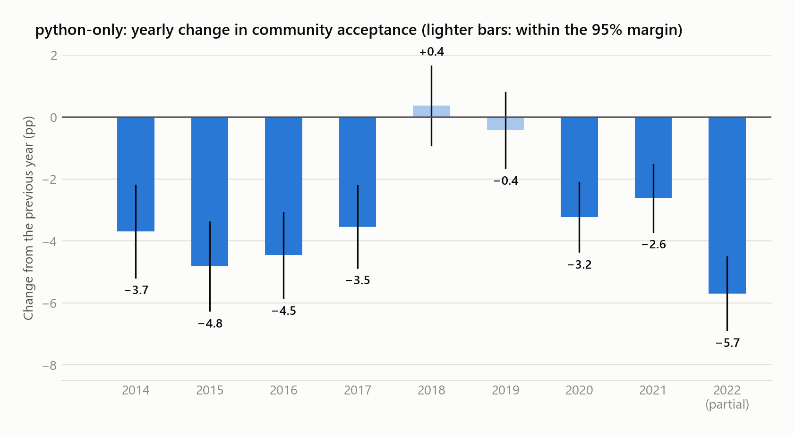
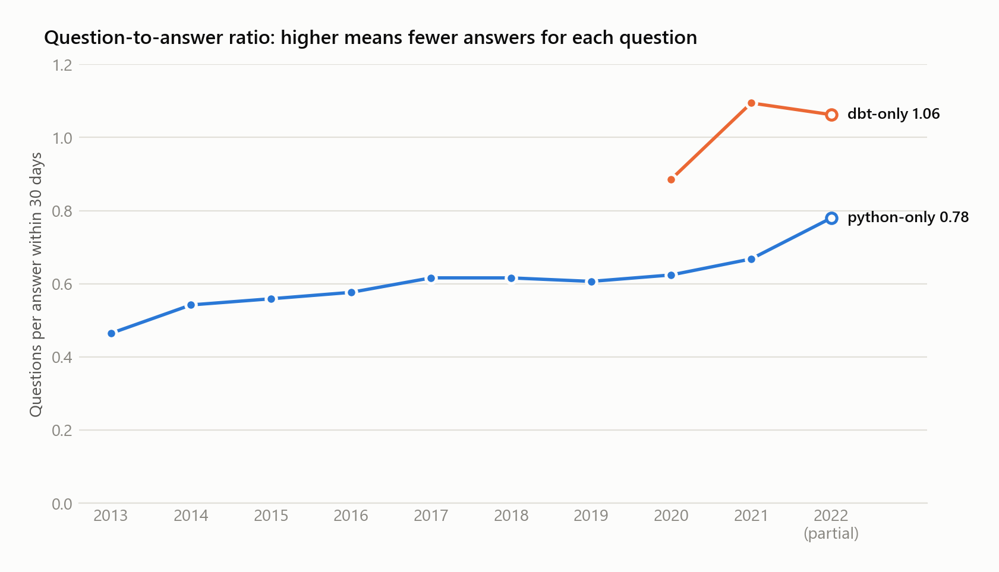
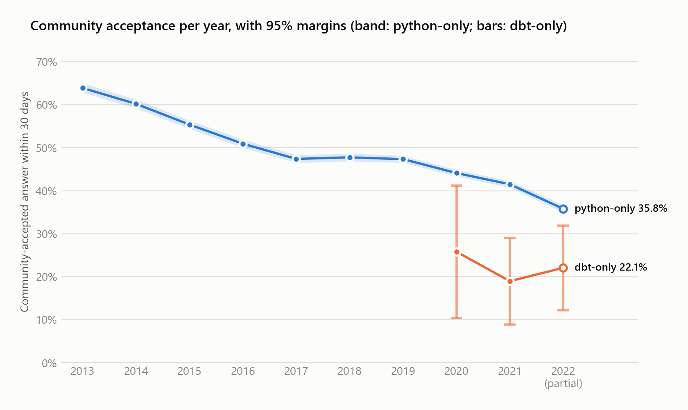

# Question 2: python vs dbt, year over year

> *For posts which are tagged with only 'python' or 'dbt', what is the year over year change of
> question-to-answer ratio for the last 10 years? How about the rate of approved answers on the
> same time period? How do questions tagged with only 'python' compare to questions only tagged
> with 'dbt'?*

**Answer (2013–2022; 2022 runs to late August):**
- **Question-to-answer ratio:** python-only rose from 0.46 (2013) to 0.67 (2021), +44%, so
  each question gets fewer answers; the yearly changes range from −1.6% to +16.7%, and 2022
  adds +16.7% (0.78). dbt-only exists only from 2020: 0.89, then +23.6% and −2.9%.
- **Approved answers:** python-only community acceptance fell from 63.9% to 41.5% (2013–2021,
  about −2.8 pp a year), and 6 of the 8 yearly drops exceed their margin of error; 2022 adds
  −5.7 pp, probably overstated. dbt-only changed −6.8 pp and +3.1 pp, both within a margin of
  about ±14–18 pp: no dbt trend can be stated.
- **python vs dbt:** dbt-only questions get fewer answers (ratio 0.89–1.09 vs 0.62–0.78 in
  2020–2022) and about half the acceptance (21.7% vs 41.0% pooled, a gap of 19.3 ± 6.5 pp).
- **Confidence:** high for the python decline; moderate for the python vs dbt gap (157 dbt
  questions); none for a dbt trend.

## Executive summary

- **python-only questions show a long decline in answers and acceptance from 2013 to 2021:**
  - the question-to-answer ratio rose from 0.46 to 0.67 (+44%), so answers per question fell from
    2.15 to 1.50;
  - community acceptance fell from 63.9% to 41.5% (−22.4 pp), about −2.8 pp per year;
  - 6 of the 8 yearly changes in community acceptance are declines larger than their margin of
    error. The two exceptions form a plateau in 2018–2019.

  The trend describes the questions present in the 2022 snapshot. Questions deleted over the
  years are absent, which may affect the comparison between years; the size of that effect was
  not measured.
- **2022 continues the decline with the largest drop in acceptance in the series** (ratio
  +16.7%, community acceptance −5.7 pp). Two effects may push 2022 in the same direction as the
  decline: survivorship and the acceptance-date proxy. It is also a partial year. The direction
  of the 2022 change is consistent with the trend; its size may be overstated, by an unknown
  amount.
- **dbt has no 10-year series.** No question is tagged only `dbt` before 2020. There are 31, 58
  and 68 such questions in 2020, 2021 and 2022, so there are only two year-over-year changes:
  community acceptance −6.8 pp, then +3.1 pp. Both lie well within the margin of error of a
  change (about ±14–18 pp). **No dbt trend can be stated.**
- **In the same years, dbt shows lower observed levels than python.**
  - dbt-only questions have a higher question-to-answer ratio every year (0.89–1.09, against
    0.62–0.78 for python). They get fewer than one answer per question in 2021 and 2022 (0.91
    and 0.94), and 1.13 in 2020.
  - Their community acceptance is about half of python's (21.7% vs 41.0%, 2020–2022 pooled). The
    gap is clearest in 2021 and in the pooled years; 2020 and 2022 alone are weak evidence.
- **The comparison between the tags rests on levels, not on trends.** Two noisy dbt changes
  cannot be set against python's nine.

## Methodology

**Data.** `bigquery-public-data.stackoverflow`, a static snapshot whose last question is dated
2022-09-25.

**Population.**
- **"Only python" / "only dbt"** = the question has exactly one tag, and it is `python` or `dbt`.
- **`dbt` is the data build tool.** Its tag excerpt reads: "Questions relating to dbt (data build
  tool) set up and usage". No other tag refers to it: the other tags containing "dbt" (such as
  `mdbtools` and `sqldbtype`) are unrelated.
- **The last 10 years** = 2013 to 2022, the ten latest years in the dump.
- **2022 is partial.** It keeps only questions with a complete 30-day observation window, created
  from 2022-01-01 to about 2022-08-26. This cuts 2022 from 12,809 to 11,157 python questions and
  from 79 to 68 dbt questions.
- **Volume.** 117,505 python-only and 157 dbt-only questions in total.

**Observation window.**
- **Answers** count only if posted within 30 days of the question, so a 2013 question has no
  advantage over a 2022 one in answers. 94.7% of first answers in the dump arrive within 30 days.
- **Acceptance** follows that rule only in part. The snapshot has no acceptance date, so a
  question counts as accepted when its accepted answer was *posted* within 30 days. The
  acceptance itself may have happened later, at any time up to the snapshot.
- **Consequence:** older questions had more time for such an answer to be accepted, which may
  affect the comparison between years. The size of this effect was not measured.

**Metric definitions.** All metrics are per tag and per creation year.

| Metric | Definition |
|---|---|
| `total_questions` | questions in the group; the denominator of the rates |
| `total_answers` | answers posted within 30 days. A question with three answers adds three |
| `question_to_answer_ratio` | total_questions / total_answers, the question's wording read literally. **A higher ratio means fewer answers per question** |
| `answers_per_question` | total_answers / total_questions, the inverse, as in Q1 |
| `community_accepted_rate` | questions whose accepted answer was posted within 30 days (the acceptance itself may be later) and written by someone other than the asker, divided by total_questions. **The main acceptance metric** |
| `accepted_rate` | the same, with self-accepted answers included |

Community acceptance is the main rate for the same reason as in Q1: a self-accepted answer was
written by the asker, not by the community. It matters more for dbt: 3 of the 11 accepted answers
in 2020 were self-accepted.

**Year-over-year change.**
- **Ratio: relative change in %**, (this year / previous year − 1) × 100. From 0.50 to 0.60 is
  +20%.
- **Rates: difference in percentage points.** From 30% to 35% is +5 pp.
- A change is empty when either year has no questions.

**Margin of error.** 95% margins use the normal approximation, computed from the exported counts.
Two kinds are reported:
- **For a single rate:** ±0.8–1.1 pp for python, ±10–15 pp for dbt.
- **For a difference between two rates**, either a year-over-year change or the python vs dbt
  gap: the margin of the difference between two independent proportions, not the margin of
  either rate. It is ±1.1–1.5 pp for a python change and ±14–20 pp for a dbt change.

The normal approximation is limited at 31–68 questions a year, so the dbt margins are indicative
only. A difference whose interval only just excludes zero is weak evidence. No margin was computed
for the ratio.

## Only python

| Year | Questions | Answers | Ratio | Ratio YoY | Community-accepted | YoY (pp) | Accepted, incl. self | YoY (pp) |
|---|---:|---:|---:|---:|---:|---:|---:|---:|
| 2013 | 7,819 | 16,829 | 0.46 | | 63.9% | | 64.9% | |
| 2014 | 8,537 | 15,743 | 0.54 | +16.7% | 60.2% | −3.7 | 61.1% | −3.8 |
| 2015 | 9,781 | 17,495 | 0.56 | +3.1% | 55.4% | −4.8 | 56.5% | −4.6 |
| 2016 | 10,344 | 17,939 | 0.58 | +3.1% | 50.9% | −4.5 | 52.2% | −4.4 |
| 2017 | 11,683 | 18,958 | 0.62 | +6.9% | 47.4% | −3.5 | 48.8% | −3.4 |
| 2018 | 11,614 | 18,849 | 0.62 | 0.0% | 47.8% | +0.4 | 48.8% | 0.0 |
| 2019 | 14,503 | 23,909 | 0.61 | −1.6% | 47.3% | −0.4 | 48.5% | −0.3 |
| 2020 | 16,256 | 26,042 | 0.62 | +2.9% | 44.1% | −3.2 | 45.3% | −3.3 |
| 2021 | 15,811 | 23,670 | 0.67 | +7.0% | 41.5% | −2.6 | 42.8% | −2.4 |
| 2022 (partial) | 11,157 | 14,307 | 0.78 | +16.7% | 35.8% | −5.7 | 36.7% | −6.1 |

**Facts**
- **Questions grew faster than answers.** Questions doubled from 2013 to 2020 (7,819 → 16,256);
  answers grew by 55% (16,829 → 26,042).
- **The ratio rose in 6 of the 8 changes from 2013 to 2021**, and was flat or slightly down in
  2018–2019. The 2014 jump (+16.7%) is as large as 2022's.
- **Community acceptance fell in 6 of those 8 changes by more than the margin of the change**
  (±1.1–1.5 pp).
  The 2018 and 2019 changes (+0.4 and −0.4 pp) are within the margin.
- **Self-acceptance barely matters for python.** The two acceptance rates differ by 0.9–1.4 pp
  every year and move together.
- **The answered share falls too.** Questions with an answer within 30 days fell from 96.5%
  (2013) to 83.7% (2021) and 75.1% (2022). Fewer questions get any answer at all, not only fewer
  answers each.

**What the trend describes.** These are the python-only questions present in the 2022 snapshot.
Questions deleted in earlier years are absent. If deletions affected some years more than others,
the comparison between years is affected too; this was not measured.

**Why 2022 needs caution.** Two effects may lower its rates, in the direction of the decline, and
a third adds uncertainty:
1. **Survivorship.**
   - *Documented rule* ([stackoverflow_rules.md](stackoverflow_rules.md)): Stack Overflow's
     automatic cleanup, the "Roomba", deletes after about one year the unanswered questions that
     meet its criteria, a score of 0 or less among them. Not every unanswered, low-score question
     is deleted. Deleted posts are not in the dump.
   - *Measured, site-wide* ([data_quality.md](data_quality.md)): among all questions, the share
     of unanswered ones with a score ≤ 0 jumps from 12.5% (August 2021) to 26.6% (October 2021),
     about one year before the snapshot.
   - *Interpretation:* questions from 2022, and from roughly the last quarter of 2021, have not
     yet passed the one-year rule, so they may still include questions that will later be
     deleted. Such questions are unanswered, so they would raise the ratio and lower the rates of
     those years.
   - *Not measured:* how many python-only or dbt-only questions this affects.
2. **Acceptance date.** The dump has no acceptance date, so the accepted answer's posting date is
   used. An answer posted within 30 days may have been accepted at any time up to the snapshot: a
   2013 question had years for that, a 2022 question a few months.
3. **Partial year.** 2022 covers January to August; whether those months differ from a full year,
   and in which direction, was not measured.

The size of each effect was not measured. Since 2013–2021 already declines steadily, a further
2022 decline is plausible, but −5.7 pp should not be read as the real change.

## Only dbt

| Year | Questions | Answers | Answered | Ratio | Ratio YoY | Community-accepted | YoY (pp) | Accepted, incl. self | YoY (pp) |
|---|---:|---:|---:|---:|---:|---:|---:|---:|---:|
| 2013–2019 | 0 | 0 | 0 | | | | | | |
| 2020 | 31 | 35 | 27 | 0.89 | | 25.8% | | 35.5% | |
| 2021 | 58 | 53 | 44 | 1.09 | +23.6% | 19.0% | −6.8 | 24.1% | −11.3 |
| 2022 (partial) | 68 | 64 | 54 | 1.06 | −2.9% | 22.1% | +3.1 | 23.5% | −0.6 |

**Facts**
- **There is no dbt-only question before 2020.** The `dbt` tag first appears in 2019, on 3
  questions that also carry other tags. The report keeps 2013–2019 as rows with 0 questions and
  empty rates, so the missing years are visible instead of hidden.
- **Only two year-over-year changes exist.** In community acceptance they are −6.8 pp (margin of
  the change ±18 pp) and +3.1 pp (±14 pp). Neither can be told apart from no change.
- **The ratio moves a lot on small numbers.** With 35–64 answers a year, a single extra answer
  moves the ratio by 1.5–3%. The +23.6% of 2021 is 58 questions and 53 answers against 31 and 35.
- **The two acceptance rates diverge for dbt.** In 2020, 3 of the 11 accepted answers were
  self-accepted, so the accepted rate (35.5%) is well above community acceptance (25.8%).
- **dbt-only is a large slice of dbt, python-only a small slice of python.** From 2019 to 2022,
  168 of the 674 dbt questions (25%) carry only that tag. For python the share is 6–8% per year
  in the profiled years (whole years).

## python vs dbt in the same years

| Year | Questions python / dbt | Ratio python / dbt | Community-accepted python / dbt | Gap ± margin of the difference (pp) |
|---|---:|---:|---:|---:|
| 2020 | 16,256 / 31 | 0.62 / 0.89 | 44.1% / 25.8% | 18.3 ± 15.4 |
| 2021 | 15,811 / 58 | 0.67 / 1.09 | 41.5% / 19.0% | 22.5 ± 10.1 |
| 2022 (partial) | 11,157 / 68 | 0.78 / 1.06 | 35.8% / 22.1% | 13.7 ± 9.9 |
| 2020–2022 pooled | 43,224 / 157 | 0.68 / 1.03 | 41.0% / 21.7% | 19.3 ± 6.5 |

**Facts**
- **dbt has the higher question-to-answer ratio every year.** In answers per question, the
  inverse, dbt gets 1.13 in 2020, then fewer than one in 2021 and 2022 (0.91 and 0.94). python
  gets 1.60, 1.50 and 1.28.
- **dbt has about half of python's observed community acceptance.**
  - The gap is clearest in 2021 (22.5 ± 10.1 pp) and in the pooled years (19.3 ± 6.5 pp).
  - In 2020 and 2022 the interval excludes zero only by a few points (lower ends of about 3 and
    4 pp), on 31 and 68 dbt questions and a rough approximation. Each of those years alone is
    weak evidence of a gap, 2020 especially.
  - The direction of the gap is the same in all three years.
- **With self-accepted answers included, the 2020 gap is not distinguishable** (9.8 ± 16.9 pp).
  The 2021 and 2022 gaps remain (18.7 ± 11.0 and 13.2 ± 10.1 pp).
- **The year-over-year changes cannot be compared.** python's changes are measured to about
  ±1.5 pp; dbt's to about ±14–20 pp.

**Why a same-year comparison.** Comparing the two tags within a year holds the calendar
constant: questions of the same age, observed for the same window, under the same deletion
rules. It does not remove survivorship. The same rules do not mean the same effect: how many
questions each tag loses depends on its own share of unanswered, low-score questions, which the
dump cannot show.

**Inference (not tested).** dbt was a young, small tag in these years: 674 questions in the whole
dump, against about 2 million for python. Fewer people could answer its questions, which fits
both the fewer answers per question and the lower acceptance.

## Confidence

- **python, 2013–2021: high** for the direction, among the questions present in the snapshot.
  The decline appears in both rates and in the ratio, is larger than the margin in 6 of 8 yearly
  changes, and comes from about 8,000–16,000 questions a year.
- **python, 2022: low** for the size of the change. The direction is consistent with the trend;
  the size may be pushed by two biases in the same direction, in a partial year.
- **dbt trend: none.** Two changes, each within its margin of error.
- **python vs dbt level: moderate.** The observed gap has the same direction in all three years
  and is clear pooled, but rests on 157 dbt questions. 2020 and 2022 alone are weak evidence, and
  survivorship may affect the two tags differently.

## Limitations

1. **Association, not causation.** The tag marks the kind of question; it does not explain why
   python acceptance falls or why dbt's is lower.
2. **"Only one tag" is a narrow population.** It covers 6–8% of python questions and 25% of
   dbt questions. The results describe single-tag questions, not the tags as a whole.
3. **Survivorship.** Deleted questions are absent. Stack Overflow deletes certain unanswered
   questions after about one year ([stackoverflow_rules.md](stackoverflow_rules.md)). Questions
   younger than that at the snapshot (late 2021 and 2022) may still include future deletions,
   which would make their rates look lower than those of older years. The size of this bias was
   not measured, and it may differ between tags and between years.
4. **Acceptance date is approximated.** A question counts as accepted when its accepted answer
   was posted within 30 days; the acceptance itself may have happened later, up to the snapshot.
   Older questions had more time for that, which can lower the acceptance rates of the latest
   years, 2022 most. The size of this effect was not measured.
5. **Partial year.** "2022" covers January to late August.
6. **Small dbt samples.** 31–68 questions a year; the margins of error are indicative only.
7. **Current tags.** Tags can be edited after posting; a question counts under the tags it has in
   the snapshot.
8. **Answers posted before their question.** 507 such answers exist in the dump and are counted
   (see `data_quality.md`). How many fall in this population was not measured.

## Reproducibility

- **Model.** `models/reports/rpt_q2_python_dbt_by_year.sql`, built on
  `models/marts/fct_questions.sql`; column definitions and tests in
  `models/reports/_reports_models.yml`.
- **Export.** `results/q2_python_dbt_by_year.csv` (20 rows: 2 tags × 10 years).
- **Profiling.** `queries/profiling/10_python_dbt_volume.sql` gives the whole-year counts, the
  questions with `dbt` among other tags and the share of single-tag questions.
- **The `dbt` tag.** `queries/q2/01_dbt_like_tags.sql` lists every tag containing "dbt" with its
  official excerpt.
- **Derived figures.** Two scripts in `scripts/q2/` read only the export; they run no query and
  need no dbt. Run them from the repository root with Python 3.10+ (standard library only):
  - `derived_statistics.py` prints the derived figures: the margins of error, the python decline
    and how many yearly changes exceed their margin, the dbt changes, answers per question, the
    answered share, the pooled 2020–2022 rates and the gaps. It prints labelled values to compare
    with this report; it is not a pass/fail check. Run `python scripts/q2/derived_statistics.py`.
  - `check_doc.py` checks the three tables of this report against the export. Numbers quoted in
    the running text are not checked by it. Run `python scripts/q2/check_doc.py`.
- **Charts.** `scripts/q2/charts.py` draws the three charts of this report into `docs/images/`
  from the export. It needs matplotlib (`requirements.txt`). Run `python scripts/q2/charts.py`.
